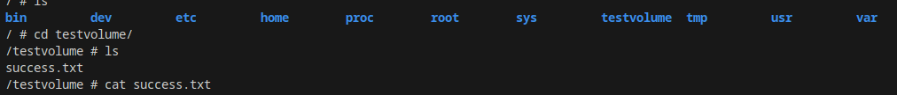
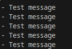
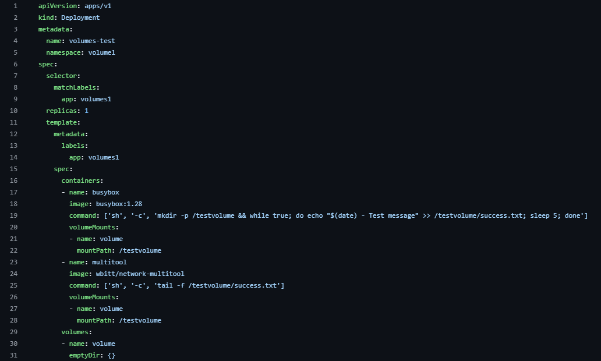
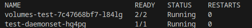
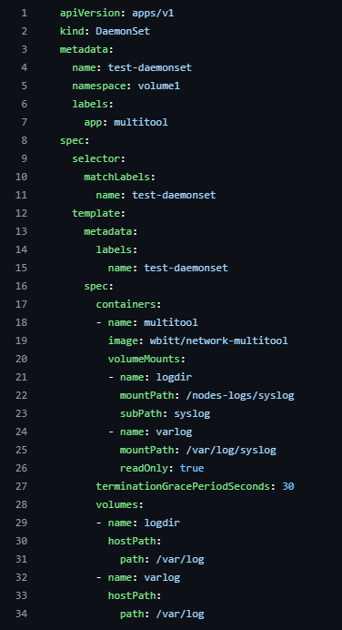

# Домашнее задание к занятию «Хранение в K8s»

## Задание 1. Volume: обмен данными между контейнерами в поде
### Задача

Создать Deployment приложения, состоящего из двух контейнеров, обменивающихся данными.

### Решение 1.

### Решение 2.

### Описание реализации доступа к логам

Для организации чтения файла `/var/log/syslog` кластера MicroK8S внутри контейнера применяется следующий подход:

* **Использование `subPath`**: вместо монтирования всей директории `/var/log` с хост-машины, будет монтироваться только целевой файл `syslog`. Это позволяет изолировать конкретный файл и не пробрасывать лишние системные данные в контейнер.
* **Режим `readOnly`**: монтирование будет выполнено в режиме «только для чтения». Это необходимо для предотвращения конфликтов доступа и защиты целостности системного лога на узле MicroK8S.
