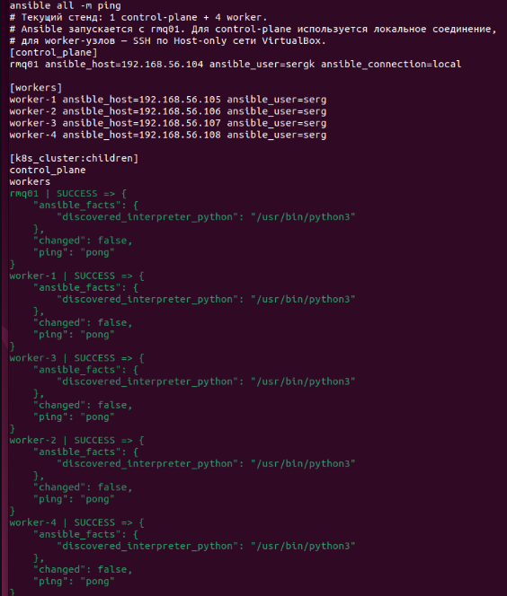
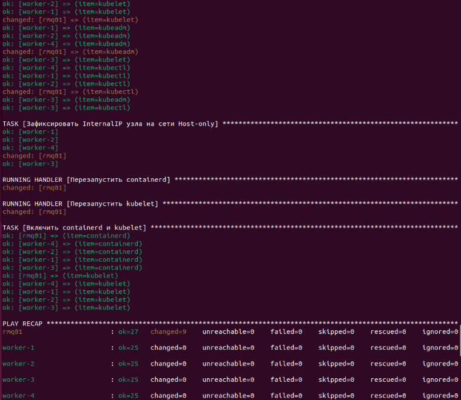
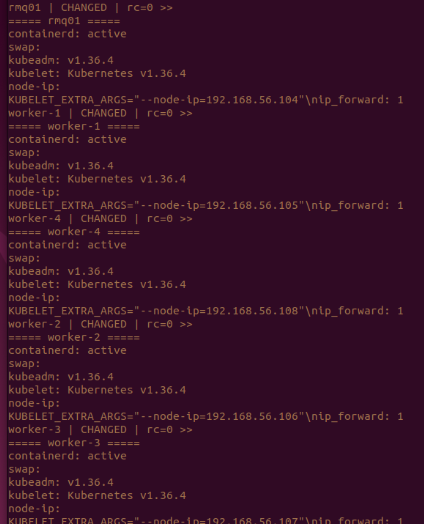
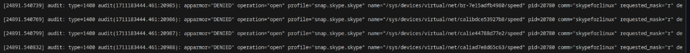
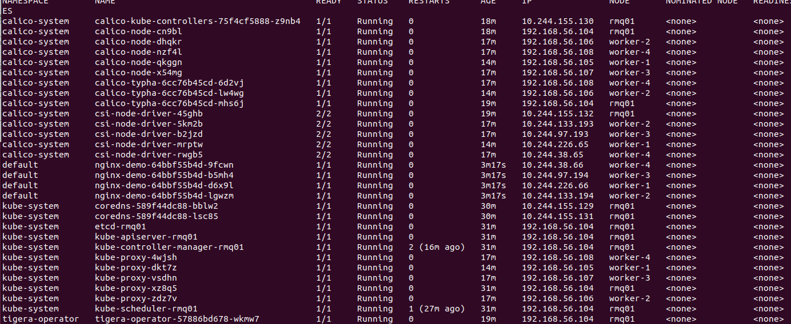
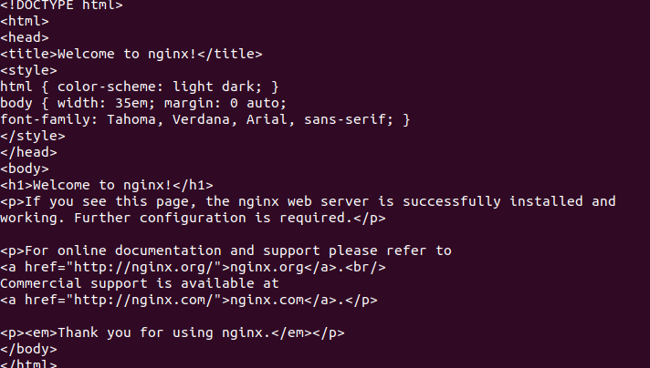
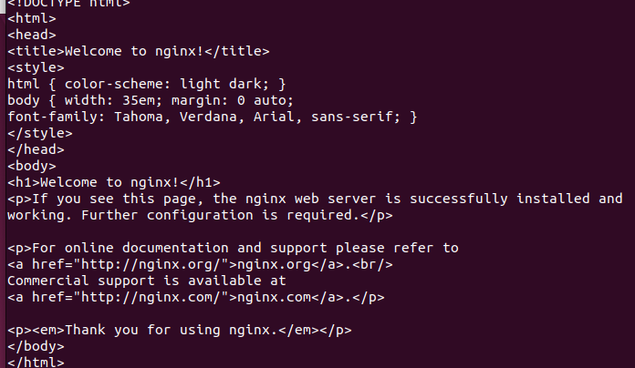

# Домашнее задание к занятию «Установка Kubernetes»

### Задание 1. Установить кластер k8s с 1 master node

1. Подготовка работы кластера из 5 нод: 1 мастер и 4 рабочие ноды.
2. В качестве CRI — containerd.
3. Запуск etcd производить на мастере.
4. Способ установки выбрать самостоятельно.

###  Kubernetes Cluster Setup Task

### Пример

## Task Description
**Task 1:** Deploy a Kubernetes (k8s) cluster with 1 Master node.

### Requirements:
* **Cluster Topology:** 5 nodes in total (1 Master node + 4 Worker nodes).
* **CRI (Container Runtime Interface):** `containerd`.
* **etcd Deployment:** Must run on the **Master node**.
* **Installation Method:** Self-selected (e.g., kubeadm, k3s, or manual deployment).

## Environment
* **OS:** Debian Linux
* **Nodes:**
    | Role | Count |
    | :--- | :--- |
    | Master | 1 |
    | Worker | 4 |

# 1. Создаем директорию проекта
mkdir k8s-cluster-task && cd k8s-cluster-task

# 2. Инициализируем git
git init

# 3. Создаем README.md с заданием
cat <<EOF > README.md
# Kubernetes Cluster Setup Task

## Task Description
**Task 1:** Deploy a Kubernetes (k8s) cluster with 1 Master node.

### Requirements:
* **Cluster Topology:** 5 nodes in total (1 Master node + 4 Worker nodes).
* **CRI (Container Runtime Interface):** \`containerd\`.
* **etcd Deployment:** Must run on the **Master node**.
* **Installation Method:** Self-selected.

## Environment
* **OS:** Debian Linux
* **Nodes:**
    | Role | Count |
    | :--- | :--- |
    | Master | 1 |
    | Worker | 4 |
EOF

# 4. Добавляем файлы и делаем первый коммит
git add README.md
git commit -m "docs: add task description"

# 5. Инструкция по пушу (замените URL на ваш)
# git remote add origin https://github.com/YOUR_USERNAME/YOUR_REPO_NAME.git
# git branch -M main
# git push -u origin main

